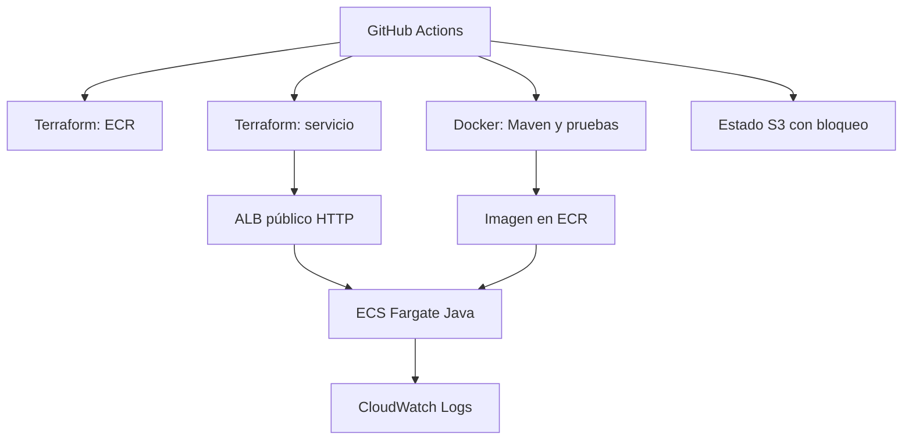

# Java + Docker + Terraform + ECS + GitHub Actions

Solución para la prueba técnica DevOps de BanBif. Incluye una API Hola Mundo en Java 21, compilación y pruebas Maven dentro de Docker, imagen runtime en ECR y despliegue de ECS Fargate mediante Terraform. El endpoint público se obtiene al completar el workflow.

**Estado de entrega:** código preparado para desplegar. La URL y la ejecución AWS deben generarse en la cuenta sandbox del postulante. No se incluyen credenciales ni evidencia ficticia de despliegue.

## Inicio rápido: ejecutar hoy

1. Crea un repositorio GitHub vacío, por ejemplo `banbif-devops-challenge` (público para revisión, si la convocatoria lo permite).
2. Extrae este proyecto y sube **todo su contenido**, incluyendo `.github/`, `infra/`, `scripts/`, `app/`, Dockerfile y los archivos ocultos. La carpeta `.github` debe quedar en la raíz del repositorio, no dentro de otra carpeta.
3. Configura el acceso AWS con una de las opciones de abajo, antes de ejecutar el despliegue.
4. En GitHub, abre **Actions → Build, publish and deploy → Run workflow → main**. Se ejecuta también con cada push a `main`; en pull requests solo valida, sin acceso AWS.
5. Espera la ejecución y abre su **Summary**. Encontrarás `Public URL` y `Health`. Abre `/api/hello` y verifica `Hola Mundo`.
6. Actualiza `docs/ENTREGA.md` con las URLs reales del repositorio, ejecución y aplicación. Mantén los recursos activos hasta que evalúen la prueba.

### Subir el código desde PowerShell (Windows)

Abre PowerShell **dentro de la carpeta extraída**, donde está este README. Instala Git si no lo tienes y ejecuta cada línea:

```powershell
git init -b main
git add .
git commit -m "Implement Java API with ECS Terraform and GitHub Actions"
git remote add origin https://github.com/TU_USUARIO/banbif-devops-challenge.git
git push -u origin main
```

Sustituye `TU_USUARIO` y el nombre real del repositorio. Autoriza GitHub mediante el navegador cuando Git lo solicite; no pegues tokens en comandos ni en el código. Si el primer workflow falla por falta de acceso AWS, configura las variables y vuelve a ejecutarlo.

## Acceso AWS: elegir una opción

En GitHub: **Settings → Secrets and variables → Actions**. Variables en pestaña **Variables**; credenciales únicamente en **Secrets**. El job usa el environment `production`; en **Settings → Environments → production** limita deployment branches a `main`. Si tu plan lo permite, añade aprobación antes del despliegue.

| Nombre | Tipo | Valor |
|---|---|---|
| `AWS_REGION` | Variable | `us-east-1` u otra región autorizada con al menos 2 AZ |
| `PROJECT_NAME` | Variable | `banbif-demo`; 3-18 caracteres minúsculos, números y guiones |
| `AWS_ROLE_ARN` | Variable, opción A | ARN del rol OIDC de despliegue; deja vacío para opción B |
| `ECS_EXECUTION_ROLE_ARN` | Variable, opcional | Rol de ejecución ECS existente, por ejemplo el ARN real de `LabRole` |
| `AWS_ACCESS_KEY_ID` | Secret, opción B | Credencial de la sesión sandbox |
| `AWS_SECRET_ACCESS_KEY` | Secret, opción B | Secreto de la sesión sandbox |
| `AWS_SESSION_TOKEN` | Secret, opción B | Token de sesión temporal, obligatorio si tu sandbox lo proporciona |

### Opción A: OIDC (recomendada, si puedes gestionar IAM)

No utiliza claves permanentes. Desde AWS CloudShell, con la misma cuenta sandbox y permisos de IAM:

1. Sube la carpeta `scripts` a CloudShell, o clona tu repositorio público.
2. Desde la raíz ejecuta:

```bash
bash scripts/setup-oidc.sh TU_USUARIO/banbif-devops-challenge us-east-1 banbif-demo
```

3. Copia el ARN que muestra el script en la variable GitHub `AWS_ROLE_ARN`.
4. La confianza permite exclusivamente el repositorio indicado y el environment `production`. Protege ese environment restringiéndolo a `main`.

El script crea/reutiliza el proveedor OIDC GitHub, un rol de despliegue y una política para este ejercicio. ECR, S3, logs e IAM se restringen al proyecto; los permisos de EC2/ECS/ELB son amplios dentro de la región elegida para permitir crear la red y el servicio. **Es un bootstrap de sandbox, no una política corporativa de producción.** No lo ejecutes sobre un rol preexistente que tenga otro propósito. Si ya existe el proveedor OIDC, debe incluir el audience `sts.amazonaws.com`.

### Opción B: sandbox educativo o cuenta con IAM restringido

1. Inicia la sesión del laboratorio y copia sus credenciales AWS temporales a los tres Secrets indicados.
2. Deja vacía `AWS_ROLE_ARN`.
3. Si no puedes crear roles, configura `ECS_EXECUTION_ROLE_ARN` con el rol ECS permitido (ejemplo: `LabRole`, usando su ARN real).
4. La sesión debe permitir pasar ese rol a ECS (`iam:PassRole`), además de crear ECR, ECS, ELB, VPC, logs y el bucket de estado.
5. Si aparece `AccessDenied`, solicita los permisos al administrador o usa otro sandbox autorizado. Las credenciales temporales no eliminan las restricciones de la cuenta.

Las credenciales pueden vencer; renueva los Secrets y reejecuta. No compartas sus valores ni capturas donde aparezcan. El sandbox debe permitir ALB, Fargate y direcciones IPv4 públicas. No cambies de región, nombre de proyecto o cuenta tras crear recursos sin destruirlos primero: esos valores determinan el backend.

## Arquitectura



- VPC dedicada y dos subredes en zonas distintas.
- ALB público en puerto 80. Tasks aceptan puerto 8080 **solo desde el SG del ALB**.
- Fargate usa IPv4 pública para descargar ECR y enviar logs, evitando el costo fijo de NAT Gateway. No admite conexiones entrantes directas desde Internet.
- Una tarea por defecto para reducir costo del ejercicio. Dos subredes no equivalen a dos réplicas; para redundancia de la aplicación usa `desired_count=2` y valida distribución por zona.
- Sin base de datos: el enunciado admite explícitamente Hola Mundo.
- HTTP deliberado para evaluación sin dominio. Para producción: dominio, certificado ACM y listener HTTPS, tasks privadas con NAT o VPC endpoints, alta disponibilidad y política de permisos más restrictiva.

## Aplicación y Docker

Java 21 con servidor HTTP del JDK; no requiere framework ni base de datos. Maven fija versiones de plugins y ejecuta cinco pruebas HTTP de contrato. El Dockerfile tiene dos etapas:

1. `maven:3.9.9-eclipse-temurin-21`: descarga dependencias, compila, prueba y empaqueta.
2. `eclipse-temurin:21-jre-alpine`: contiene solo runtime y JAR; usuario no root, puerto 8080.

El contenedor en ECS tiene sistema de archivos de solo lectura y limita el heap según la memoria del contenedor. Los tags de imágenes base están versionados por familia; en un entorno regulado fijaría también sus digests y actualizaría mediante revisiones automatizadas.

| Método | Ruta | Respuesta |
|---|---|---|
| GET | `/` | 200, JSON Hola Mundo |
| GET | `/api/hello` | 200, JSON Hola Mundo |
| GET | `/health` | 200, `{"status":"UP"}` |
| GET | ruta inexistente | 404 |
| POST y otros | cualquier ruta | 405 |

Prueba local con Docker Desktop:

```powershell
docker build -t banbif-java .
docker run --rm --read-only --tmpfs /tmp -p 8080:8080 banbif-java
```

En otra consola:

```powershell
Invoke-RestMethod http://localhost:8080/api/hello
Invoke-RestMethod http://localhost:8080/health
```

## Flujo de automatización

1. Validación Terraform: formato, inicialización sin backend y validación de ambos stacks.
2. Docker build ejecuta Maven y pruebas dentro del contenedor; se prueba también la imagen runtime por HTTP.
3. Job de despliegue autentica vía OIDC o sesión temporal del sandbox.
4. Bootstrap idempotente del bucket S3: versionamiento, cifrado, bloqueo de acceso público y política TLS. Se hace por AWS CLI porque el backend debe existir antes de inicializar Terraform.
5. Terraform crea ECR (`infra/registry`), con tags inmutables, escaneo al publicar y limpieza de imágenes sin tag.
6. Docker compila y publica una imagen identificada por commit + ejecución + intento.
7. Se obtiene el digest y se despliega `repository@sha256:...`; no se utiliza `latest`.
8. Terraform crea red, balanceador, logs, cluster, task definition y servicio (`infra/service`). Guarda el plan y aplica exactamente ese archivo.
9. ECS espera estabilidad y el pipeline valida el endpoint público; guarda outputs y smoke test como artifact.

Los planes se conservan dentro de la ejecución, no en Git ni como artifacts públicos. El escaneo de ECR está habilitado, pero **esta versión no espera sus resultados ni bloquea despliegues por severidad**. No se incluye Checkov/SonarQube porque no son obligatorios en este enunciado. Las pruebas de la aplicación sí bloquean la entrega.

Concurrencia de GitHub desactiva cancelaciones de despliegues y serializa deploy/destroy. El backend S3 utiliza `use_lockfile=true`; no requiere DynamoDB. Registry y service tienen claves de estado separadas. El versionamiento facilita recuperar estado; no reemplaza un rollback de la infraestructura.

La aplicación no necesita un task role con acceso AWS. El execution role permite a ECS descargar la imagen y enviar logs. Si se usa LabRole, sus permisos los controla el sandbox y no esta solución.

## Rollback y recuperación

El servicio usa despliegue rolling, `minimum_healthy_percent=100`, capacidad temporal del 200% y circuit breaker con rollback. En la primera publicación aún no existe una versión estable anterior a la que volver. Una actualización que falle debe investigarse en ECS y CloudWatch; no se considera exitosa solo porque Terraform haya terminado: el smoke test también debe pasar.

Para volver a una versión previa, conserva su digest ECR y aplícalo como `TF_VAR_image_uri` mediante Terraform con el mismo backend. Las imágenes etiquetadas no se eliminan automáticamente para conservar releases; revisa y borra las antiguas cuando ya no se necesiten. Después de una interrupción de Terraform, genera un nuevo plan: no reutilices un plan anterior a cambios del estado.

## Limpieza de recursos y costos

**ECS Fargate, ALB, ECR, S3, logs e IPv4 públicas pueden generar cargos.** No se presume que estén cubiertos por capa gratuita. El sandbox se usa únicamente para la prueba. Mantén el endpoint activo hasta la revisión y después destruye los recursos.

En **Actions → Destroy sandbox resources → Run workflow**, escribe `DESTROY`. Usa la misma cuenta, región, proyecto y configuración de rol. Borra primero el servicio y luego ECR; `force_delete=true` permite eliminar sus imágenes. Conserva el bucket de estado y sus versiones intencionalmente para auditoría. El proveedor OIDC y el rol de GitHub creados por bootstrap también permanecen; elimínalos solo si no los utiliza otro proyecto. Si la sesión venció, renueva primero los Secrets para poder limpiar.

## Solución rápida de problemas

| Error | Revisar |
|---|---|
| `Not authorized to perform sts:AssumeRoleWithWebIdentity` | ARN, proveedor OIDC, audience, repositorio exacto y environment `production` |
| `ExpiredToken` / `InvalidClientTokenId` | Renovar las tres credenciales temporales del laboratorio |
| `iam:CreateRole AccessDenied` | Usar `ECS_EXECUTION_ROLE_ARN` permitido o solicitar permisos |
| `iam:PassRole AccessDenied` | Autorizar al rol del pipeline a pasar el execution role a ECS |
| Error inicial de servicio ECS | Permiso/creación de service-linked role de ECS en la cuenta |
| `CannotPullContainerError` | Execution role, imagen ECR/digest, salida HTTPS y ruta a Internet |
| Health checks fallidos | Logs `/ecs/banbif-demo`, puerto 8080, SG y `/health` |
| Estado bloqueado | Confirmar ejecución activa; no desbloquear mientras otro apply continúa |
| Workflow no aparece | `.github/workflows/*.yml` en raíz y branch `main` |
| Cuota de VPC / ALB / IPv4 | Cuotas y restricciones del sandbox; no eliminar recursos ajenos |

## Criterios del enunciado

| Requisito | Implementación |
|---|---|
| Aplicación Java sencilla | `app/src/main/java/pe/challenge/App.java` |
| Maven dockerizado | Etapa `build` del Dockerfile |
| Runtime + compilado en ECR | Etapa `runtime`, repositorio Terraform e imagen por digest |
| Cluster mediante Terraform | `aws_ecs_cluster` en `infra/service` |
| Servicio mediante Terraform | Task definition, ECS service y ALB en `infra/service` |
| Orquestación GitHub Actions | `.github/workflows/deploy.yml` |
| Código en un repositorio | Este árbol completo, incluidos archivos ocultos |
| Endpoint público validable | Output `hello_url` y Summary de Actions tras desplegar |

## Fuentes oficiales

- [Backend S3 y bloqueo](https://developer.hashicorp.com/terraform/language/backend/s3)
- [OIDC entre GitHub y AWS](https://docs.github.com/en/actions/how-tos/secure-your-work/security-harden-deployments/oidc-in-aws)
- [Roles IAM de ECS](https://docs.aws.amazon.com/AmazonECS/latest/developerguide/security-iam-roles.html)
